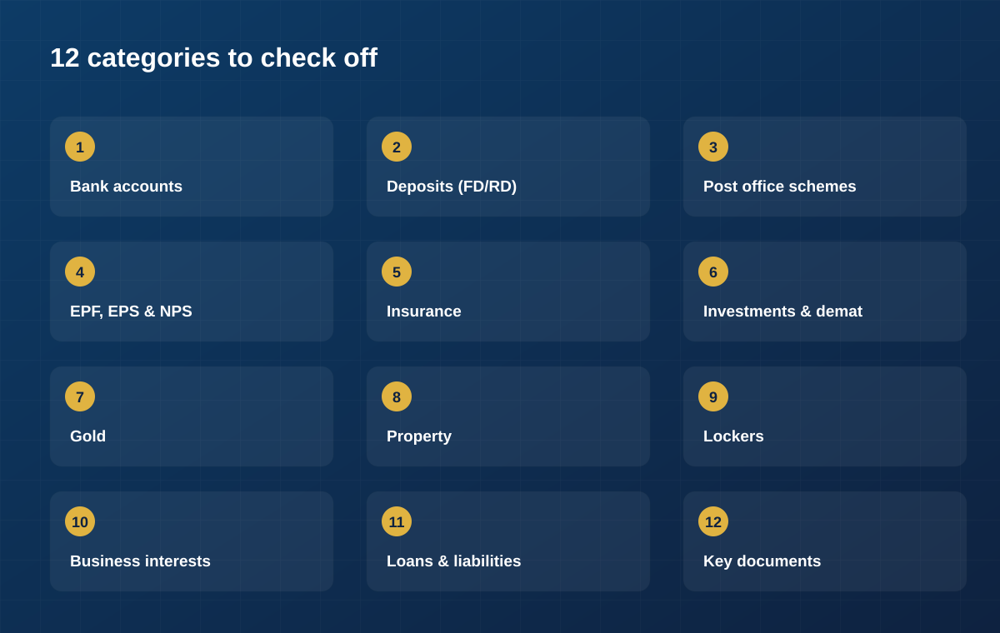

Every family has a financial life. Few families have a *list* of it. There's a
bank account here, a fixed deposit there, an old insurance policy someone
bought years ago, a mutual fund folio nobody's looked at since. None of it is
lost, exactly — it's just not written down anywhere the whole family can see.

That gap has a real, measured cost. As of March 2024, banks in India were
holding **₹78,213 crore in deposits classified as unclaimed** — accounts with
no customer activity for ten years or more — up 26% from the year before,
according to the Reserve Bank of India's own data as [reported by Business
Standard](https://www.business-standard.com/finance/news/unclaimed-deposits-with-banks-rise-26-to-rs-78-213-crore-rbi-report-124053000742_1.html).
Add to that the crores sitting in [inoperative EPF
accounts](https://retirement.outlookindia.com/plan/news/explained-epfos-new-guidelines-for-inoperative-epf-accounts),
the roughly [₹20,062 crore in unclaimed life insurance
payouts](https://www.grantthornton.in/insights/blogs/comprehensive-overview-of-unclaimed-policy-amounts-and-regulatory-measures-in-india/)
insurers were still holding as of March 2024, and shares and dividends sitting
with the government's [Investor Education and Protection Fund
Authority](https://www.mca.gov.in/MinistryV2/investorservices.html)
after seven years of no claims — and the picture is clear. This isn't money
that was stolen or mismanaged. It's money whose *existence* nobody
remembered to write down.

A financial inventory is simply the fix: one place that lists what your
family owns, so nothing sits forgotten until a bank or regulator has to go
looking for the rightful owner.

## What a financial inventory actually is

It isn't a budget, and it isn't an investment plan. It's simpler than both —
a record of three things for every asset your family holds:

- **What it is** — the type of account, policy or asset.
- **Where it lives** — which bank, insurer or institution holds it.
- **Who should know** — the nominee on record, and the family member who can
  find it if needed.

Once that's written down for everything you own, "being prepared" stops being
an abstract idea and becomes a document you can actually hand someone.

## The checklist, category by category

Work through each section below. You don't need every category to apply to
your family — just capture what does, and note the institution, account or
policy number, and current nominee for each item.

### 1. Bank accounts
Savings accounts, current accounts, salary accounts, and NRI accounts (NRE/NRO/FCNR)
if any family member has lived abroad. Include accounts you rarely use — an
old salary account from a previous job is exactly the kind of account that
turns "unclaimed" after ten years of inactivity.

### 2. Deposits
Fixed deposits (FDs) and recurring deposits (RDs), across every bank —
including small finance banks and co-operative banks, which families often
forget once the FD receipt goes into a drawer.

### 3. Post office and small savings schemes
Public Provident Fund (PPF), National Savings Certificates (NSC), Kisan Vikas
Patra (KVP), Senior Citizens' Savings Scheme (SCSS), Sukanya Samriddhi
accounts for daughters, and the ordinary Post Office Savings Account. These
are especially easy to lose track of because they don't send digital
statements the way banks do.

### 4. Retirement and provident funds
Employees' Provident Fund (EPF) and Employees' Pension Scheme (EPS) balances
from every employer you've worked for, and the National Pension System (NPS)
if you contribute to one. Job changes are the single biggest reason EPF
accounts go inoperative — an account is officially classified as inoperative
after **36 months with no contribution or claim**, per [EPFO's Standard
Operating Procedure](https://retirement.outlookindia.com/plan/news/explained-epfos-new-guidelines-for-inoperative-epf-accounts).

### 5. Insurance
Life insurance and term plans, health insurance (individual and family
floater), motor insurance, and home insurance. Note the policy number,
insurer, sum assured, and — critically — the nominee named on each policy.

### 6. Investments
Mutual fund folios, direct equity and demat accounts, and any PMS or AIF
holdings. As of SEBI's [2026 nomination
framework](https://www.sebi.gov.in/legal/circulars/may-2026/ease-of-doing-investments-modified-norms-for-nomination-in-demat-accounts-and-mutual-fund-folios_101703.html),
nomination is now mandatory by default on new single-holder demat accounts
and mutual fund folios — a good reason to check that existing ones are
actually nominated too.

### 7. Gold and precious metals
Physical gold and jewellery (and where it's stored — locker, home safe),
Sovereign Gold Bonds, gold ETFs, and digital gold holdings.

### 8. Property
Land and real estate, along with the title deed, registration papers, and
property tax records for each. Note which family member currently holds the
original documents.

### 9. Lockers
Bank lockers and their location, plus who is authorised to access them and
under what conditions.

### 10. Business interests
Ownership stakes, partnership shares, or sole proprietorship assets, if
applicable.

### 11. Loans and liabilities
Home loans, personal loans, credit cards, and any guarantees you've signed
for someone else. A complete financial picture includes what's owed, not just
what's owned — your family needs to know about liabilities just as much as
assets.

### 12. Key documents
PAN, Aadhaar, passport, and where physical or digital copies of each of the
above — passbooks, policy documents, property papers — are actually kept.

## Making the list useful, not just complete

A checklist you fill in once and never touch again drifts out of date the
moment you open a new account or close an old policy. The habit that matters
more than the first pass is the second one: revisiting it whenever something
changes, and making sure it's somewhere more than one person can reach.

That's the part most families skip — not because they don't care, but
because there's never been an easy place to keep it. A shared spreadsheet
gets outdated. A physical file lives in one drawer, in one house. Passwords
to online accounts don't get written down anywhere at all.

## Where eKosha fits

This is exactly the gap eKosha is built to close. It's a private, encrypted
place to record this same checklist — every asset, its institution, and its
nominee — and keep it current as your financial life changes.

With eKosha, you can:

- **Record each asset** across the categories that matter most — bank
  accounts, deposits, insurance, mutual funds and shares, gold, property,
  provident and pension funds, small savings, and lockers.
- **Set nominees and co-owners** on each one, so the record and the actual
  paperwork agree with each other.
- **Share securely** with the family members you trust, with view-only or
  edit access that you control and can change at any time.

Building the list is the hard part, and it only takes about fifteen minutes
to start. Keeping it current is the part that protects your family — and
that's what eKosha is for.
