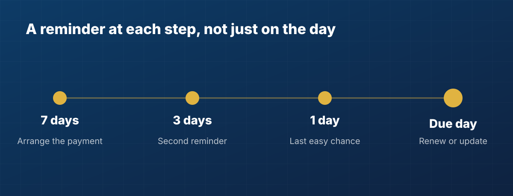

Most financial mistakes in a family are not big decisions. They are small dates
that passed quietly: a premium that was due on the 14th, a fixed deposit that
matured last month, a provident fund account nobody looked at for a year.

None of these feel urgent on any given day, which is exactly why they get missed.
The good news is that they are also some of the easiest problems to prevent.

## Why renewals slip through

A renewal has three things going against it. It happens rarely, usually once a
year. It is spread across different institutions, each with its own reminder
habits (or none). And in many households, one person carries all of the dates in
their head.

When that person is busy, unwell or simply away, the date does not move. The
premium is still due.

## The dates that matter most

### 1. Insurance premiums

Health and life premiums are the most common miss. Insurers allow a grace period
after the due date, but its length depends on the insurer, the type of policy and
how often you pay. If the grace period ends without payment, the policy can lapse.

For life insurance, a lapsed policy may be revived within a set period, usually
with the pending premiums and sometimes a medical check. For health insurance,
a break in cover can mean losing benefits you built up over the years, such as
having already served waiting periods. Check your own policy document for the
exact terms.

### 2. Insurance expiry and maturity

Health policies are renewed every year. Some life policies pay out on a maturity
date. If nobody remembers that date, the family may not claim an amount that is
rightfully theirs.

### 3. Fixed deposit maturity

When a deposit matures, many banks renew it automatically on whatever terms are
current that day, which may not be what you would have chosen. If it is not
renewed, the money often earns a lower rate until you act. Either way, a
reminder a week before gives you time to decide.

### 4. PPF, provident fund and small savings

These are long-term accounts, so it is easy to forget they have dates at all. A
PPF account matures after 15 years, and the choice to extend it, with or without
further contributions, has a time limit. Keeping the account active also depends
on a minimum yearly deposit. Your bank or post office can confirm the current
rules for your account.

## Why one reminder on the day is not enough

A single alert on the due date often arrives when it is too late to compare
options, arrange funds or find the right document. A better pattern is a few
nudges that give you room to act: a week ahead to plan, a few days ahead to
confirm, and one on the day itself so nothing slips by.

## A five-minute way to get on top of it

1. **List every policy and deposit you can think of.** Include the ones in a
   spouse's or parent's name.
2. **Write down the one date that matters for each.** The next premium due date,
   the expiry date, or the maturity date.
3. **Note who else should know.** If a parent's policy renews each year, the
   person who can pay it should see the date too.
4. **Set a reminder before the date, not on it.** A week is usually enough.
5. **Update the date when you renew.** This is the step people skip, and it is
   what makes next year's reminder work.

## Where eKosha fits

eKosha keeps those dates alongside the rest of your family's financial
information. Add a premium due date, expiry or maturity date to an asset, and
eKosha reminds you 7, 3 and 1 day before, and on the day itself. If several
renewals fall close together you get one short summary notification rather than
a stream of alerts, and it does not show account details on your lock screen.

An **Upcoming renewals** page lists everything that is due, grouped as overdue,
this week, the next 30 days and later. When you have renewed something, you can
update its date in two taps. If a reminder is not useful for one entry, you can
mute it for yourself without affecting a co-owner. Renewal reminders are
included on the free plan.

You decide how you are told: push and email can each be switched on or off, and
the in-app inbox always keeps a record.

The dates are in your family's financial life already. The aim is simply for
them to be written down somewhere the right people will see them in time.
